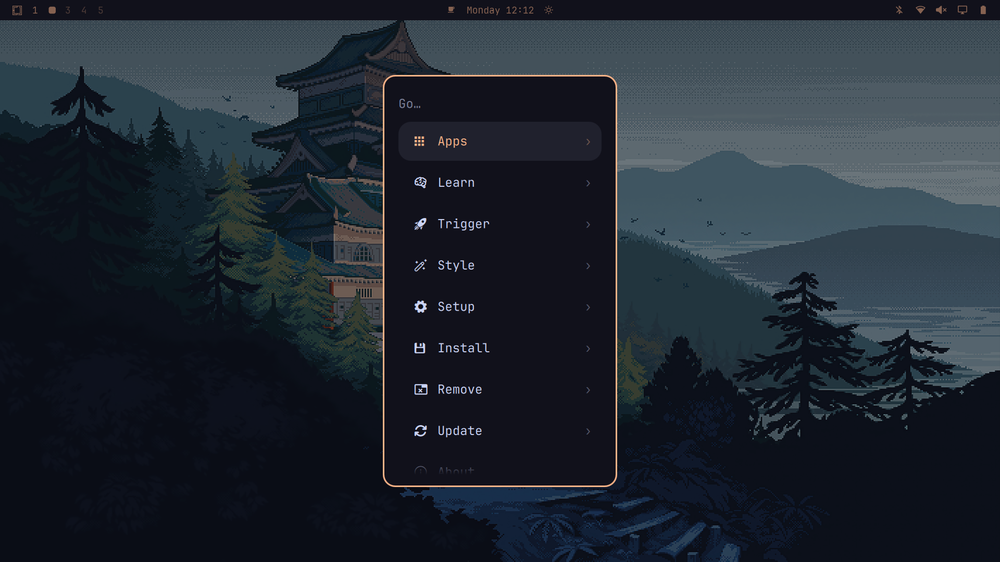

# Coppernight

Dark Omarchy theme with deep indigo tones and copper accents. It also includes a polished Hyprland look'n'feel and a bar widget for changing Hyprland settings live.



## Install (one command)

```bash
curl -fsSL https://raw.githubusercontent.com/Mehdi-Samardan/omarchy-theme/main/install.sh | bash
```

Or from a clone:

```bash
git clone https://github.com/Mehdi-Samardan/omarchy-theme.git
cd omarchy-theme
./install.sh
```

The installer:

1. Copies the theme to `~/.config/omarchy/themes/coppernight` and activates it.
2. Installs the Hyprland look'n'feel to `~/.config/hypr/looknfeel.lua`.
3. Installs the **Hyprland Tweaks** and **Video Downloader** bar widgets (top-right of the bar) and the **Dock** widget (open-app icons, left of the bar).
4. Reloads Hyprland and restarts the Omarchy shell.

Before replacing a file, the installer saves a backup next to it as `<file>.bak.<timestamp>`.

## Features

### Theme
- GTK, Hyprland, and terminal styling (Alacritty, Kitty, Ghostty, Foot)
- Editor themes: Neovim, VS Code, Zed, Helix, Sublime, Emacs, Vim
- App themes: Firefox, Chromium, Obsidian, Vencord, btop, lazygit, yazi, tmux, starship, fastfetch
- Optional icon/cursor and file-manager setup scripts
- Included wallpapers and preview assets

### Hyprland look'n'feel
- Rounded corners (8px) with a thin 1px border
- Soft window shadows
- Blur behind translucent surfaces (bar, menus, transparent windows)
- Smooth window animations with a slight spring when windows open
- Workspaces slide when you switch

### Hyprland Tweaks bar widget
Click the Hyprland logo in the top-right of the bar to open a panel with about 90 Hyprland settings. Changes apply live.

| Section | What you can change |
|---|---|
| General | Border size, gaps, layout (dwindle / master / scrolling), resize on border, snapping, tearing |
| Colors | Active and inactive border colors, shadow color |
| Decoration | Rounding and rounding curve, active/inactive/fullscreen opacity, dimming |
| Blur | Size, passes, noise, contrast, brightness, vibrancy, xray, popups |
| Shadow | Range, falloff, scale, sharpness |
| Animations | Window and workspace styles, animation speeds |
| Input | Mouse sensitivity and acceleration, focus follows mouse, scroll speed, key repeat, touchpad |
| Cursor | Screen zoom, hide when idle, cursor warping |
| Layouts | Dwindle, master and scrolling layout options |
| Groups | Group bar |
| Misc & Performance | VRR, direct scanout, terminal swallowing, wake-on-input |

- Type in the search box to find a setting.
- Settings you changed are highlighted. Click ↺, or right-click a slider, to reset one setting. **Reset all** undoes every change.
- Only the settings you change are saved, to `~/.config/hypr/tweaks.lua`, so they survive reboots.

### Dock bar widget
Icons of your open apps on the left of the bar, next to the workspaces.

- Click an icon to focus that app. Click again to cycle through its windows.
- Middle-click closes the focused window of that app.
- A small number shows when an app has more than one window open.
- Omarchy web apps get their own icon instead of Chrome's. Apps without a usable icon get one bundled with the widget (Claude, the About page), and GitHub Desktop is matched to its icon.

### Video Downloader bar widget
A download icon on the right of the bar. Click it, paste a link and pick a quality.

- If your clipboard already holds a link, it's filled in when the panel opens.
- Shows the title, thumbnail, channel and length, then the qualities on offer:
  - **Best**: the highest resolution and bitrate the site has.
  - **Each resolution** (e.g. `1080p60 · 7.4 Mbps · ~600 MB`): the highest-bitrate stream at that height, saved as MP4.
  - **MP3**: 320 kbps. **Original**: the site's own audio track, without re-encoding.
- Files get the title, channel, date and chapters embedded, and the thumbnail as cover art.
- **Several downloads at once:** up to 3 run in parallel, the rest queue. Keep pasting links while they run; each quality gets its own file name.
- Every download gets a card with its thumbnail, quality badge, MB done / total, speed, time left and percentage. The progress counts video and audio together in bytes, so it climbs once from 0 to 100%.
- **Pause / Resume** continues from where it stopped. **Cancel** leaves nothing behind. Plus **Play**, **Show in folder**, **Retry**, **Remove** and **Clear finished**.
- The list is saved, so it survives restarts and logouts; paused downloads can be resumed later, and moved or deleted files are marked.
- Downloads keep running when the panel is closed. The bar icon shows the overall percentage, the list header the total speed, and a notification fires when each one finishes. When one finishes, the link and qualities at the top clear for the next link.
- Errors are explained in plain words (private video, age-restricted, not available in your country, …).
- Saves to `~/Videos/Downloads`. Works with YouTube, X, Instagram, TikTok and the other sites [yt-dlp](https://github.com/yt-dlp/yt-dlp) supports.

Needs `yt-dlp` and `ffmpeg`. Optional, for sites that refuse or need your login, and for cover art on Opus audio:

```bash
omarchy pkg add yt-dlp ffmpeg python-secretstorage python-curl_cffi python-mutagen
```

With those, a site that refuses is retried with your browser's cookies (Chrome, Chromium, Brave or Firefox) and a browser fingerprint.

### About page (fastfetch)
A compact white OMARCHY logo over five bordered tables in the theme's colors, with a Nerd Font icon on every row.

| Table | What it shows |
|---|---|
| System | OS, user, host, kernel, init, boot, uptime, packages (+ AUR), last sync, processes, load, locale |
| Hardware | Board, BIOS, CPU, cores, CPU load / temp / governor, GPU, driver, VRAM, memory, swap, disk, drives, filesystem, display, audio |
| Network | Interface + speed, local IP, MAC, gateway, DNS, Wi-Fi, Bluetooth |
| Desktop | WM, workspaces, theme, terminal, shell, editor, browser, font, cursor, icons, keyboard, now playing |
| Dev | git, python, node, rust, go, gcc, docker, mise (only what's installed) |

- Memory, swap, disk, VRAM and CPU load get a usage bar that turns green → yellow → red.
- **SUPER + SHIFT + A** opens it tiled, like SUPER + T. It replaces Omarchy's default ChatGPT shortcut.
- It opens in foot at font size 8 so the whole page fits on a 1440p screen. Change `size=8` in `~/.config/fastfetch/launch-about.sh` to adjust.

## Optional extras

```bash
cd ~/.config/omarchy/themes/coppernight
./apply-icons.sh        # Papirus-Dark with orange folders + peach cursor
./apply-filemanager.sh  # File manager styling
./install-fastfetch.sh  # About page + SUPER+SHIFT+A shortcut
```

## Undo

```bash
cd ~/.config/omarchy/themes/coppernight
./remove-gtk.sh
./remove-icons.sh
./remove-fastfetch.sh   # About page + its shortcut
```

- **Look'n'feel:** restore `~/.config/hypr/looknfeel.lua.bak.<timestamp>`.
- **Bar widgets:** delete `~/.config/omarchy/plugins/mehdi.hyprtweaks`, `mehdi.dock` and `mehdi.downloader`, then remove those ids from `~/.config/omarchy/shell.json`.
- **Saved widget settings:** delete `~/.config/hypr/tweaks.lua`.

## Repository layout

```
.                      Theme files (copied to ~/.config/omarchy/themes/coppernight)
extras/hypr/           Hyprland look'n'feel
extras/omarchy/plugins Hyprland Tweaks, Dock and Video Downloader bar widgets
install.sh             One-command installer
```
